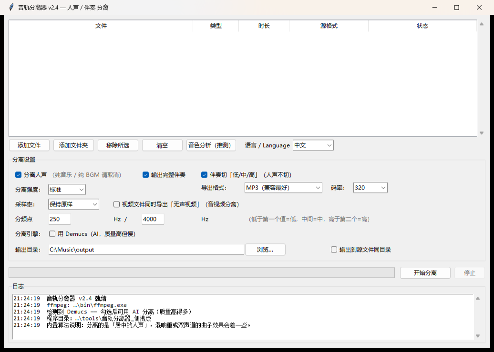
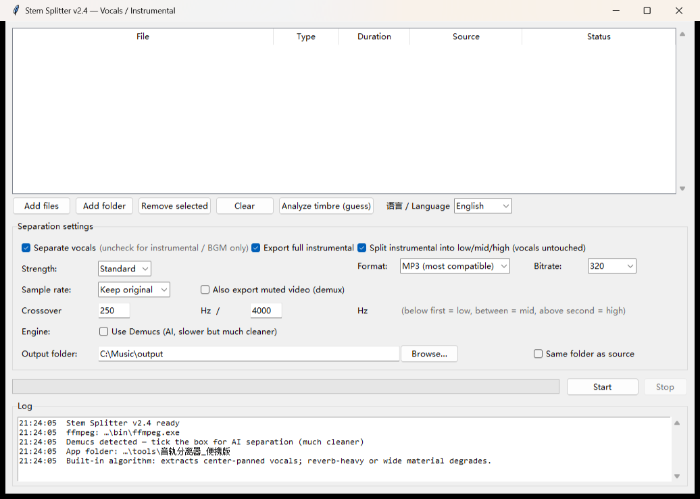

# music-stem-splitter · 音轨分离器

**中文** | [English](#english)

把一个音频或视频拆成 **人声 / 伴奏**，伴奏还能再切 **低 / 中 / 高** 三段——给 remix、采样、练唱、消音用。

纯本地运行，不联网、不上传。Windows 图形界面。




---

## 怎么用：两种方式

### ① 普通用户 — 下载便携版（**零安装**，推荐）

去右边的 **Releases**，下载最新的 `*.zip`，解压到任意文件夹（含 U 盘），
**双击 `音轨分离器.exe`** 就能用。

| 需要装什么 | 便携版 |
|---|---|
| Python | ❌ **不需要**（已打包） |
| numpy | ❌ 已打包 |
| FFmpeg | ❌ 已打包 |
| Demucs / AI 模型 | ❌ 已打包，断网也能跑 |
| 联网 | ❌ 不需要（首次运行 Demucs 也不用） |

**体积约 1.37 GB**，因为把 FFmpeg、Python、Demucs 全塞进去了。
**界面支持中英文切换**（右上角「语言 / Language」）。

### ② 开发者 — 从源码运行

仓库里只有源码（几十 KB），**不含二进制**。跑起来需要自己装依赖：

```bash
git clone https://github.com/lencedinn/music-stem-splitter.git
cd music-stem-splitter
pip install numpy
# 还需要 FFmpeg，见下面「安装」
python separator.py
```

**源码运行是纯中文界面**（语言下拉框只在打包成 exe 后才出现）。

> 两条路的界面和功能完全一样，区别只是「谁准备运行环境」。
> 想自己打包成 exe 见文末「构建便携版」。

---

## 功能

| 功能 | 说明 |
|---|---|
| **人声分离** | 分出 `人声` 和 `伴奏`；纯音乐可以关掉这一项 |
| **低/中/高切分** | 伴奏再切三段，分频点可调（默认 250 / 4000 Hz）。**三段相加严格等于原曲**（实测重建误差 9e-6） |
| **全部主流格式导出** | MP3 / FLAC / WAV / M4A / ALAC / OGG / OPUS / WMA / AIFF |
| **视频提取音频** | MP4 / MKV / MOV / AVI / FLV / WEBM / TS 等，默认只抽音轨 |
| **音视频分离** | 可额外导出一份「无声视频」（视频流原样复制，不重编码） |
| **音色推测** | 生成报告：频段分布、BPM、估计有哪些成分（鼓/贝斯/pad/pluck…）+ 依据 |
| **批量处理** | 一次丢一堆文件，文件夹递归 |
| **中英文界面** | **便携版**右上角可切换；源码运行固定中文 |

### 三种勾选框决定输出

| 分离人声 | 完整伴奏 | 切频段 | 结果 |
|---|---|---|---|
| ✅ | ✅ | ✅ | 5 个：`人声` `伴奏` `伴奏_低` `伴奏_中` `伴奏_高` |
| ✅ | ✅ | ❌ | 2 个：`人声` `伴奏` |
| ✅ | ❌ | ✅ | 4 个：`人声` `伴奏_低` `伴奏_中` `伴奏_高` |
| ✅ | ❌ | ❌ | 1 个：`人声` |
| ❌ | ✅ | ✅ | 4 个：`音频` `音频_低` `音频_中` `音频_高` |
| ❌ | ✅ | ❌ | 1 个：`音频`（等于只把音轨抽出来） |

> **人声永远不切频段**，只有伴奏/音频才切。

---

## 安装（仅源码运行需要）

> 如果你用的是 Releases 里的便携版，**这一节可以整段跳过** —— 那里什么都不用装。

### 1. Python

需要 Python **3.9+**（开发与测试用的是 3.12）。

### 2. numpy

```bash
pip install numpy
```

### 3. FFmpeg（必须）

源码版**不自带** FFmpeg，需要你自己装：

- **Windows**：从 <https://www.gyan.dev/ffmpeg/builds/> 下载 `ffmpeg-release-full.7z`，
  解压后把 `ffmpeg.exe` 和 `ffprobe.exe` 放进程序的 `bin\` 目录，**或**加入系统 PATH。
- **macOS**：`brew install ffmpeg`
- **Linux**：`sudo apt install ffmpeg`

程序启动时会依次查找：`bin\` 目录 → 系统 PATH → 常见安装路径。找不到会弹出下载提示。

### 4. Demucs（可选，强烈推荐）

Demucs 是 AI 分离模型，质量远高于内置算法：

```bash
pip install --target pylibs demucs
```

装到程序目录下的 `pylibs\` 里，重启程序即可。**首次运行 Demucs 会自动下载模型（约 80 MB）**，之后缓存到 `~/.cache/torch`。

> 不装 Demucs 也能用——内置算法是频域中心提取，秒级出结果，卡拉 OK 级别。

---

## 用法

```bash
python separator.py            # 图形界面
python separator.py --selftest # 环境自检，结果写到 自检结果.txt
```

或者双击 `run.bat`（Windows）。

---

## 两种分离算法

### ① 内置算法（纯 numpy，无机器学习依赖）

1. 左右声道分解成 **mid**（居中）和 **side**（侧向）
2. 每个频点算中心度 `mid² / (mid² + side²)`
3. 中心度高的当人声（人声几乎总在正中间）
4. 人声切掉 120 Hz 以下（低频归伴奏）
5. **伴奏 = 原曲 − 人声**（保证两轨相加等于原曲）

**局限**：只分离"居中"的成分。混响重 / 现场版 / 人声做过立体声加宽的曲子效果差；居中的乐器（贝斯、底鼓）会被一起抽走；单声道源基本没法分。

### ② Demucs（AI）

`htdemucs`，质量接近商业分轨工具。纯 CPU 下**一首 4 分钟的歌约 5–15 分钟**。

---

## 音色推测（`timbre.py`）

生成一份 txt 报告：频段分布、频谱重心、谱平坦度、起音密度、估计 BPM、衰减时间，然后推测"大概有什么"并给出依据。

**⚠️ 这不是声源识别。** 它基于可测量的物理特征 + 经验规则：

| 能做到 | 做不到 |
|---|---|
| 哪些成分、落在哪个频段 | **猜不出具体是哪款合成器**（Serum / Massive / Vital 在频谱上可以一样） |
| 打击性 vs 持续性 | 分不清钢琴还是电钢 |
| supersaw / pluck / Reese / 噪声型 | 给不出音高、和弦、调性 |
| 估计 BPM、起音密度 | 精确清单 |

准确率约六成。它的价值是**帮你快速决定从哪儿下刀**，不是给你一份精确清单。

---

## 分发与第三方许可

本仓库只有源码，不包含任何第三方二进制。

**便携版（Release 附件）里打包了 FFmpeg、Python、PyTorch、Demucs**，
它们的授权与获取方式集中在便携版目录下的 `第三方许可\`：

| 组件 | 授权 | 说明 |
|---|---|---|
| FFmpeg 9.0.2 full_build | **GPL v3** | 含 x264/x265；GPL 要求分发二进制时提供对应源码，见许可说明里的源码地址与书面要约 |
| Python 3.12 | PSF License 2.0 | |
| PyTorch 2.15.0+cpu | BSD-3-Clause | |
| Demucs 4.1.0 | MIT | 模型权重随其发布；训练数据 MUSDB18 另有条款 |
| numpy 2.3.5 | BSD-3-Clause | |
| 其它依赖 | 见各 `*.dist-info` | einops(MIT)、huggingface_hub(Apache-2.0)、lameenc(LGPL) 等 |

本程序通过**独立进程**调用 FFmpeg，不链接其代码，因此本程序自身仍按 MIT 发布。

> 想完全避开 GPL 分发义务，可以改用 **LGPL 版 FFmpeg**（不含 x264/x265）——
> 本程序只处理音频，用不到 H.264/H.265 编码器。

## 依赖与授权

本项目 MIT 授权，但依赖了这些第三方组件。**分发时请保留各自的版权声明。**

| 组件 | 授权 | 用途 | 分发注意 |
|---|---|---|---|
| **FFmpeg** | **GPL v3**（Gyan full build 含 x264/x265） | 解码 / 编码 | **本项目不打包 FFmpeg**。如你要分发二进制，必须同时提供对应源码或书面获取方式；本项目通过独立进程调用，属于聚合使用 |
| **Demucs** | **MIT** | AI 分离模型 | 保留版权声明；**权重文件不入仓库**，由用户首次运行自行下载 |
| **PyTorch** | **BSD-3-Clause** | Demucs 的推理后端 | 保留版权声明 |
| **numpy** | **BSD-3-Clause** | 内置算法 | 保留版权声明 |
| **Python** | **PSF License** | 运行时 | 保留版权声明 |
| htdemucs 权重 | 随 Demucs 发布（MIT 仓库） | 模型参数 | 训练数据为 MUSDB18，有独立条款；本项目不提供该文件 |

**结论**：仓库只放源码（几十 KB）。二进制（FFmpeg / Python 运行时 / Demucs 环境）**不放仓库**——
要么用 Releases 单独发，要么让用户按上面「安装」自己装。

---

## 构建便携版（可选）

想把程序放进 U 盘带走，可以自行打包：

```bash
pip install pyinstaller
pyinstaller --noconfirm --windowed --name "stem-splitter" ^
    --hidden-import timbre --hidden-import i18n --paths . separator.py
```

打包产物里：

- `bin\` 放 `ffmpeg.exe` / `ffprobe.exe`
- AI 分离需要另外准备 `runtime\`（一份 Python）和 `pylibs\`（demucs + torch）
- 模型可以放进 `torchcache\hub\checkpoints\`，程序会自动用它，不用联网下载

**打包后才会出现语言切换下拉框**（`i18n.py` 里的开关判断 `sys.frozen`），源码运行不受影响。

---

## 已知限制

- 内置算法对混响重、现场版、单声道素材效果差
- 音色推测只能给"类型"，给不了型号
- FFmpeg 需自行安装（见上）
- 不做任何加密格式（NCM / QMC / KGM / KWM 等）的解密——本项目只处理未加密音频

## 授权

[MIT](LICENSE) © 2026 stem-splitter contributors

---
---

<a id="english"></a>

# stem-splitter (English)

**English** | [中文](#music-stem-splitter--音轨分离器)

Split any audio or video into **vocals / instrumental**, then optionally cut the instrumental into **low / mid / high** bands — for remixing, sampling, karaoke, and practice.

Runs **100% locally**. No upload, no network. Windows GUI.

---

## Two ways to use it

### ① Most people — download the portable build (**zero install**)

Grab the latest `*.zip` from **Releases**, extract anywhere (USB stick works),
and double-click `音轨分离器.exe` (Stem Splitter).

| Do you need to install anything? | Portable build |
|---|---|
| Python | ❌ **no** (bundled) |
| numpy | ❌ bundled |
| FFmpeg | ❌ bundled |
| Demucs / AI model | ❌ bundled, works offline |
| Internet | ❌ not required |

**~1.37 GB unpacked**, because FFmpeg, Python and Demucs are all inside.
The UI can be switched **Chinese / English** (top right: 「语言 / Language」).

### ② Developers — run from source

This repository contains **source only** (tens of KB, no binaries):

```bash
git clone https://github.com/lencedinn/music-stem-splitter.git
cd music-stem-splitter
pip install numpy
# FFmpeg is also required — see "Install" below
python separator.py
```

**Running from source is Chinese-only** (the language dropdown is only enabled in the packaged exe).

> Same features either way — the only difference is who prepares the runtime.
> To build your own exe, see "Build the portable version" at the end.

---

## Features

| Feature | Description |
|---|---|
| **Vocal separation** | Produces `vocals` and `instrumental`; can be disabled for instrumental-only material |
| **Low/mid/high split** | Instrumental is split into 3 bands with adjustable crossovers (default 250 / 4000 Hz). **The three bands sum back to the original exactly** (measured reconstruction error 9e-6) |
| **All common formats** | MP3 / FLAC / WAV / M4A / ALAC / OGG / OPUS / WMA / AIFF |
| **Video → audio** | MP4 / MKV / MOV / AVI / FLV / WEBM / TS; extracts the audio track only by default |
| **Audio/video demux** | Optionally also exports a silent video (video stream copied, not re-encoded) |
| **Timbre guess** | Report: band distribution, BPM, likely elements (drums/bass/pad/pluck…) with reasoning |
| **Batch** | Drop a whole folder, recursive |
| **UI language** | Chinese / English toggle in the **portable build**; source build is Chinese |

### Three checkboxes decide the output

| Separate vocals | Full instrumental | Split bands | Result |
|---|---|---|---|
| ✅ | ✅ | ✅ | 5 files: vocals, instrumental, + low/mid/high |
| ✅ | ✅ | ❌ | 2 files: vocals, instrumental |
| ✅ | ❌ | ✅ | 4 files: vocals + 3 bands |
| ✅ | ❌ | ❌ | 1 file: vocals |
| ❌ | ✅ | ✅ | 4 files: full audio + 3 bands |
| ❌ | ✅ | ❌ | 1 file: full audio (i.e. plain extraction) |

> **Vocals are never band-split** — only the instrumental/audio is.

---

## Install (source runs only)

> Using the portable build from Releases? **Skip this whole section** — nothing to install.

1. **Python 3.9+**
2. **numpy** — `pip install numpy`
3. **FFmpeg (required for source runs; it is bundled in the portable build)**
   - Windows: download from <https://www.gyan.dev/ffmpeg/builds/>, put `ffmpeg.exe` and `ffprobe.exe` into `bin\` or onto `PATH`
   - macOS: `brew install ffmpeg`
   - Linux: `sudo apt install ffmpeg`
4. **Demucs (optional, recommended)** — `pip install --target pylibs demucs`
   The model (~80 MB) is downloaded automatically on first use.

The app looks for FFmpeg in `bin\`, then `PATH`, then common install locations; if missing it shows a download prompt.

---

## Usage

```bash
python separator.py             # GUI
python separator.py --selftest  # writes 环境自检/self-test report
```

or double-click `run.bat` (Windows).

---

## Algorithms

**Built-in (pure numpy)**: mid/side center extraction with a soft spectral mask; vocals high-passed at 120 Hz; instrumental = original − vocals (so the two stems sum back to the original). Seconds per track. Weakness: only isolates *center* content — heavy reverb, live recordings, or widened vocals degrade; centered instruments (kick, bass) bleed into the vocal stem; mono sources cannot be separated.

**Demucs (AI)**: `htdemucs`, much cleaner. On CPU expect **5–15 minutes per 4-minute track**.

---

## Timbre guess — what it is and isn't

It measures band distribution, spectral centroid, spectral flatness, onset density, estimated BPM and decay time, then guesses likely elements with stated reasoning.

**It is not source separation / instrument recognition.** It cannot identify *which* synthesizer was used — Serum, Massive and Vital can produce spectrally identical supersaws. Accuracy is roughly 60%; it helps you decide where to cut, not to produce an inventory.

---

## Distribution and third-party licenses

This repository contains **source only** — no third-party binaries.

**The portable build (Release asset) bundles FFmpeg, Python, PyTorch and Demucs.**
Their licenses and source information are collected in `第三方许可\` (third-party notices)
inside that folder:

| Component | License | Note |
|---|---|---|
| FFmpeg 9.0.2 full_build | **GPL v3** | includes x264/x265; GPL requires source availability when distributing the binary — see the notice file for source URL and written offer |
| Python 3.12 | PSF License 2.0 | |
| PyTorch 2.15.0+cpu | BSD-3-Clause | |
| Demucs 4.1.0 | MIT | model weights ship with it; training data MUSDB18 has separate terms |
| numpy 2.3.5 | BSD-3-Clause | |
| Other deps | see each `*.dist-info` | einops (MIT), huggingface_hub (Apache-2.0), lameenc (LGPL), … |

FFmpeg is invoked as a **separate process** (not linked), so this project itself remains MIT.

> To avoid GPL distribution duties entirely, swap in an **LGPL FFmpeg build**
> (without x264/x265) — this tool only handles audio and never needs H.264/H.265.

## Dependencies and licenses

This project is MIT, but it depends on third-party components. **Keep their notices when redistributing.**

| Component | License | Role | Note |
|---|---|---|---|
| **FFmpeg** | **GPL v3** (Gyan full build, includes x264/x265) | decode / encode | **Not bundled here.** If you redistribute binaries you must also provide the corresponding source (or a written offer). This project invokes it as a separate process |
| **Demucs** | **MIT** | AI separation model | Keep the notice; **model weights are not in this repo** |
| **PyTorch** | **BSD-3-Clause** | inference backend | Keep the notice |
| **numpy** | **BSD-3-Clause** | built-in algorithm | Keep the notice |
| **Python** | **PSF License** | runtime | Keep the notice |
| htdemucs weights | shipped with Demucs (MIT repo) | model params | Trained on MUSDB18, which has its own terms; not distributed here |

**So**: this repository contains **source only** (tens of KB). Binaries are not committed —
publish them separately via Releases, or let users install them as described above.

---

## Known limitations

- Built-in algorithm is poor on reverb-heavy, live, or mono material
- Timbre guess gives *types*, never models
- FFmpeg must be installed separately
- **No decryption** of platform-encrypted formats (NCM / QMC / KGM / KWM). This project only handles unencrypted audio.

## License

[MIT](LICENSE) © 2026 stem-splitter contributors
